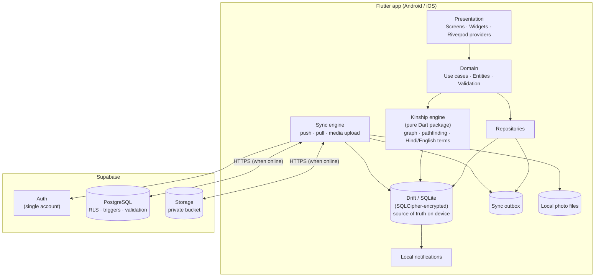
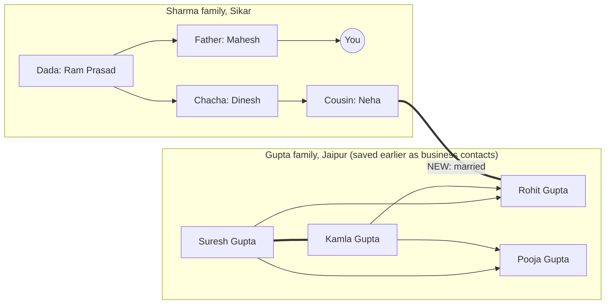

# Parichit (परिचित) — Complete Technical Blueprint

> **Your people, your families, your connections — even without internet.**
> आपके लोग, आपके परिवार, आपके रिश्ते — बिना इंटरनेट के भी।

| | |
|---|---|
| Document version | v2 · 13 Nov 2026 |
| Purpose | Family genealogy **and** personal network manager |
| Users | Single user (only me), possibly on more than one device |
| Connectivity | Offline-first; cloud sync and backup when online |
| Languages | Hindi + English (UI, relation names, search in both scripts) |
| Platforms | Android first, iOS later (same Flutter codebase) |
| Working name | **Parichit** (परिचित, "a known person"). It can be renamed at any time. |

---

## Table of contents

1. [Product vision and core principles](#1-product-vision-and-core-principles)
2. [Feature list](#2-feature-list)
3. [System architecture](#3-system-architecture)
4. [The relationship engine (the heart of the app)](#4-the-relationship-engine-the-heart-of-the-app)
5. [Database design — Supabase PostgreSQL](#5-database-design--supabase-postgresql)
6. [Local database — Drift / SQLite](#6-local-database--drift--sqlite)
7. [Offline-first sync engine](#7-offline-first-sync-engine)
8. [Search, Hindi/English and duplicate detection](#8-search-hindienglish-and-duplicate-detection)
9. [UI/UX design system](#9-uiux-design-system)
10. [Screens and user flows](#10-screens-and-user-flows)
11. [Flutter project structure](#11-flutter-project-structure)
12. [Packages](#12-packages)
13. [Security, privacy and backups](#13-security-privacy-and-backups)
14. [Testing strategy](#14-testing-strategy)
15. [Development roadmap](#15-development-roadmap)
16. [Decisions taken and future ideas](#16-decisions-taken-and-future-ideas)

---

# 1. Product vision and core principles

Parichit combines two things in one private app:

1. **Family genealogy.** It covers parents, children, spouses, siblings, in-laws and extended family across any number of generations.
2. **Personal network.** It records the people you meet: their occupation, village, family, how you know them, every meeting with them, and follow-ups.

Both parts share **one connected graph of people**. A business contact can turn out to be your cousin's father-in-law. When you add the link that shows this, the app connects the two families automatically and tells you exactly how you are related.

### Core principles

| # | Principle | What it means in practice |
|---|---|---|
| 1 | **Offline-first** | Every screen reads and writes the local database. The internet is only used for sync and backup and is never required. |
| 2 | **Store facts, derive relations** | Only primitive facts are stored: *parent of*, *spouse of*, *knows*. Relations such as uncle, mama, sasur, bhabhi and cousin are **calculated**, so they can never become inconsistent. |
| 3 | **One graph, no islands** | Families are not separate silos. A single new link joins two family trees immediately. |
| 4 | **Fast capture** | Adding a person takes 10 to 20 seconds and adding a relative takes 3 taps. Details can be filled in later. |
| 5 | **Bilingual by design** | Names are stored in both scripts and relation names are shown in Hindi and English (e.g. *Mama · मामा*). Search works with either script. |
| 6 | **Private by default** | Single account, row-level security, encrypted local database, app lock, private photo storage. |
| 7 | **Never lose data** | Soft deletes, a trash with restore, an undo for every action, cloud sync and encrypted export files. |

### Target performance (on a mid-range Android phone)

| Metric | Target |
|---|---|
| Cold start to usable home screen | < 2 s |
| Search results while typing (20,000 people) | < 100 ms |
| "Relation to me" for every person (20,000 people) | < 300 ms, computed in a background isolate |
| Quick Add, from open to saved | < 20 s of user time |

---

# 2. Feature list

### 2.1 People
- Quick Add (name, phone, village, how you know them, note) and a full detailed form.
- Names in both scripts (e.g. *Ramesh Sharma* / *रमेश शर्मा*) plus nicknames, maiden names and alternate spellings.
- Multiple phones and emails, with WhatsApp marked. Multiple addresses (home, native village, work).
- Partial and approximate dates: "born around 1955", or year only, or month and year.
- Living or deceased (shown with the respectful prefix *Late* / *स्व.*), death date, and death anniversary (*barsi*) reminders.
- Native village (*paitrik gaon*), birth place, gotra, occupation, organisation, designation and education.
- Custom fields (key and value) for anything else.
- Profile photo and photo gallery.
- Favourites, tags and family groups.
- Import from phone contacts. Call and WhatsApp in one tap. Share a person as a vCard.

### 2.2 Family and relationships
- Add relatives from any profile: **Father, Mother, Husband/Wife, Son, Daughter, Brother, Sister**, plus compound relations such as **Chacha, Tau, Bua, Mama, Mausi, Nana, Dada, Sasur, Saas, Devar, Jeth, Nanad, Sala, Sali, Bhabhi, Jija, Samdhi** and more. The app builds the required links itself.
- **Placeholders** for unknown people. For example, "Amit and Rahul are brothers but I don't know their father's name" creates an *Unknown father* that can be filled in or linked later.
- **Automatic inverse relations.** Rahul → father is Ramesh, so Ramesh → son is Rahul. Nothing is stored twice.
- **Relation to me** shown on every person (e.g. *Your Mama's son · ममेरा भाई*).
- **Relationship finder.** Pick any two people and see how they are connected, with the full chain and the Hindi and English name of the relation, including alternate paths.
- **Automatic family merging.** When two families become linked, all their members become related to each other and to you.
- Support for adoption, step-parents, half-siblings, second marriages, divorce and widowhood.
- Elder and younger distinction where Indian kinship needs it (Tau vs Chacha, Jeth vs Devar, Didi vs choti behen).
- Data checks: nobody can be their own ancestor, a person has at most two biological parents, and implausible ages produce a warning.
- **Family groups** (e.g. *Sharma Parivar, Sikar*) with gotra, kuldevta and native village. The app also detects connected family clusters automatically.

### 2.3 Family tree
- Hourglass tree around any person: ancestors above, descendants below, spouses side by side.
- Expand and collapse each branch, pinch to zoom, pan, and "Center on me".
- Modes: **Tree**, **Ancestors**, **Descendants**, and **List** (an indented list that is easy to read on small screens).
- Tap a person to open their profile. Long-press for actions such as *Add relative*, *Make root* and *Find relation to me*.
- Export the tree as an image or PDF poster.

### 2.4 Personal network
- **Social connections** between people: friend, colleague, business, neighbour, classmate, "introduced by", political, community.
- "How I know them" for every contact.
- **Meetings and interactions**: meetings, phone calls, visits and events such as weddings and functions, with **multiple participants** per meeting, place, notes, photos and a follow-up date.
- A meeting timeline on every profile.
- **Reconnect list** of people you haven't met in 30, 60 or 90 days.

### 2.5 Reminders
- Automatic birthdays, marriage anniversaries and death anniversaries (*barsi*), computed from people's data.
- Manual follow-ups ("Call Rahul about the land papers"), one-time or repeating.
- Local notifications that work fully offline.

### 2.6 Search and filters
- Instant search across names in both scripts, nicknames, phone digits, village, occupation and notes.
- Filters: tag, village, district, occupation, family group, relation side (paternal, maternal, in-laws), living or deceased, last met, upcoming birthday.
- Saved filters such as "All doctors from Sikar district" or "Everyone in Gupta family, Jaipur".

### 2.7 Data quality
- Duplicate warning before saving (same phone number, or a similar name in the same village or family).
- A **merge** screen that combines two records of the same person field by field, moves all their relations, and keeps an undo record.
- A trash with restore.

### 2.8 Backup, sync and export
- Automatic two-way cloud sync (Supabase) whenever the internet is available.
- Encrypted backup file (`.parichit`) that can be saved to Drive or shared to WhatsApp.
- Export people to CSV or Excel.
- Export and import **GEDCOM**, the universal family-tree format used by Ancestry, FamilySearch and MyHeritage.

### 2.9 Settings and security
- Language (हिंदी / English / follow system), light, dark or system theme.
- App lock with PIN, fingerprint or face, and auto-lock after a timeout.
- Sync status, sync issues, and the "Sync now" button.

---

# 3. System architecture



### How it works

- The UI **never** waits for the network. Every read is a reactive Drift query (`watch()`), so screens update the moment data changes, whether the change was made locally or arrived through sync.
- Every write is a **single local transaction** that saves the record **and** adds an entry to the sync outbox. Data cannot be saved without being queued for sync, and the reverse cannot happen either.
- The **kinship engine** is a pure Dart package with no Flutter or database dependencies. It receives the graph as plain data and returns paths and relation names. This makes it easy to test exhaustively.
- **Supabase** stores the cloud copy and enforces ownership (RLS) and data rules (triggers). The app can be used without ever signing in; signing in turns on cloud backup.

### Technology decisions

| Layer | Choice | Why |
|---|---|---|
| UI framework | Flutter (Dart) | One codebase for Android and iOS with excellent performance |
| Architecture | Feature-first + clean layers (data / domain / presentation) | Each feature stays self-contained and testable |
| State management | Riverpod (with code generation) | Compile-safe, testable, works well with Drift streams |
| Navigation | GoRouter | Declarative routes, deep links, nested bottom-tab navigation |
| Local DB | Drift (SQLite) + SQLCipher | Relational joins, recursive queries, FTS5 search, reactive streams, encryption |
| Cloud | Supabase (PostgreSQL, Auth, Storage) | Real SQL, RLS, triggers, generous free tier |
| Sync | Custom outbox + cursor-based pull | Simple and fully under your control for a single user |
| Localization | Flutter `gen-l10n` (ARB files) + a bilingual kinship dictionary | Standard Flutter approach; relation names need their own data file |
| Family tree | Custom layout + `InteractiveViewer` + `CustomPainter` | Full control over Indian family layouts; generic graph libraries draw family trees poorly |
| Background work | WorkManager on Android; sync on open, resume and reconnect | Background execution on mobile is best-effort, so the app also syncs on these events |

> **Note on Realtime:** Supabase Realtime is **not** used for sync. It is useful for live notifications, but it doesn't replace a durable outbox and cursor. For a single user it isn't needed at all.

---

# 4. The relationship engine (the heart of the app)

This section answers the most important requirement: **"I keep adding relations; when one family's roots connect to another family, everything should connect automatically, even for long and complex relations."**

## 4.1 The key idea: store only primitive facts

The earlier draft stored relations such as `Rahul → Ramesh = father` together with a second, inverse row. That approach breaks down at scale:

- Every relation needs an inverse row that must be kept consistent.
- Relations such as *uncle* or *cousin* would have to be typed in by hand, and they become wrong when the data changes.
- Two families can only become connected if you manually add relations between many pairs of people.

**The new design stores just three kinds of facts (edges)**. Every other relation is calculated from them.

| Stored fact | Table | Example |
|---|---|---|
| **Parent → child** | `parent_child` | Ramesh is the father of Rahul (biological / adoptive / step / foster / guardian) |
| **Partner ↔ partner** | `partnerships` | Rahul married Priya in 2015 (married / engaged / divorced / widowed) |
| **Social tie** | `social_connections` | Rahul is a friend of Amit; Suresh introduced Mohan |

Gender, date of birth and birth order are stored on each person. With these three edge types, the engine can work out **any** relation, at any distance:

- Brother = a son of my parent (other than me)
- Chacha = a younger brother of my father
- Mami = the wife of my mother's brother
- Samdhi = the father of my child's spouse
- …and relations with no common name, such as *my father's sister's husband's brother's daughter-in-law*.

The inverse is free. If Ramesh is Rahul's father, the same single edge, read in the other direction, says Rahul is Ramesh's son.

## 4.2 How families connect automatically

Every person is a node and every fact is an edge in **one graph**. There are no separate "family trees" in the database; a "family" is just a part of the graph.



Before the new link, Suresh Gupta was only a business contact. After you add **one edge**, "Neha married Rohit", the following happens immediately:

| Person | Computed relation to you |
|---|---|
| Rohit | Cousin's husband · *चचेरी बहन के पति (जीजा)* |
| Suresh Gupta | Cousin's father-in-law · *चचेरी बहन के ससुर* |
| Kamla Gupta | Cousin's mother-in-law · *चचेरी बहन की सास* |
| Pooja | Cousin's sister-in-law · *चचेरी बहन की ननद* |
| Dinesh (your Chacha) ↔ Suresh | Samdhi · *समधी* (the fathers of a married couple) |

Every relative of the Gupta family that you add later is connected to you automatically as well. Suppose you later find that Pooja's husband is your Mama's son. Adding that one link creates a **second path** between the families, and the Relationship Finder shows both paths.

### Merging duplicate people also connects families

Families often turn out to be linked because the same person was saved twice, once in each family (for example "Ram Kishor ji" in your wife's family and "R. K. Agarwal" as a business contact). When you **merge** the two records, every edge from both is moved to the surviving person, and the two family graphs become one. The same applies to **placeholders**: when you find out who "Unknown father of Amit" really is, you link the placeholder to the real person and all connections join up.

## 4.3 Placeholders: adding long relations without knowing everyone in between

Often you know *that* someone is your Mama's son-in-law without knowing your Mama's daughter's name. The engine therefore allows **placeholder people** (`is_placeholder = true`):

1. You open your own profile and choose **Add relative → Mama's son-in-law (मामा का दामाद)**.
2. The engine breaks this down into primitive steps: *mother → mother's brother → his daughter → her husband*.
3. For each step it uses the existing person if there is exactly one match, **asks you** if there are several (e.g. "Which Mama?"), and **creates a placeholder** if there is none ("Daughter of Ramesh Mama").
4. Placeholders appear with a dashed avatar and a **Fill details / Link to existing person** button.

As a result, the graph is always structurally correct, and long relations can be recorded in one step.

## 4.4 Path finding

The engine loads a compact, read-only adjacency list from the local database (about 60 bytes per edge, so 100,000 edges use roughly 6 MB) and runs a **weighted shortest-path search (Dijkstra)** in a background isolate.

| Step | Cost | Reason |
|---|---|---|
| Up to a parent / down to a child | 1.0 | Blood relation |
| To a spouse | 1.1 | Blood paths are preferred over marriage paths of the same length |
| Social tie (only when enabled in the finder) | 3.0 | Used only when there is no family path |

**Post-processing turns raw steps into a readable chain:**

1. **Sibling compression.** *Up to parent P, then down to a different child Q* becomes a single **sibling** step. It is a *full* sibling if they share both parents and a *half* sibling otherwise.
2. **Seniority.** For each sibling step, the engine compares birth dates. If those are missing it uses `birth_order`; otherwise seniority is *unknown*. This decides Tau vs Chacha, Jeth vs Devar and Didi vs younger sister.
3. **Tokenising.** Each step becomes a token based on the gender of the person reached:

| Step | Male | Female | Unknown |
|---|---|---|---|
| Parent | `F` | `M` | `P` |
| Child | `S` | `D` | `C` |
| Spouse | `H` | `W` | `Sp` |
| Sibling | `B` (`eB` elder / `yB` younger) | `Z` (`eZ` / `yZ`) | `Sb` |
| Social | `Fr` friend, `Co` colleague, … | | |

The path from you to Neha (your father's younger brother's daughter) is `F.yB.D`.

## 4.5 Turning a path into a relation name (Hindi + English)

The key is looked up in a **bilingual kinship dictionary** (`packages/kinship/assets/kinship_terms.json`, about 150 entries). If there is no exact match, the engine tries again without the elder/younger markers, and if that also fails it **builds a description** step by step.

### Core dictionary (excerpt)

| Key | English | हिंदी | Side |
|---|---|---|---|
| `F` / `M` | Father / Mother | पिता / माता | direct |
| `eB` / `yB` / `eZ` / `yZ` | Elder brother / Younger brother / Elder sister / Younger sister | बड़े भैया / छोटा भाई / दीदी / छोटी बहन | direct |
| `S` / `D` | Son / Daughter | बेटा / बेटी | direct |
| `H` / `W` | Husband / Wife | पति / पत्नी | direct |
| `F.F` / `F.M` | Paternal grandfather / grandmother | दादा / दादी | paternal |
| `M.F` / `M.M` | Maternal grandfather / grandmother | नाना / नानी | maternal |
| `F.F.F` / `M.F.F` | Great-grandfather (paternal / maternal) | परदादा / परनाना | paternal / maternal |
| `F.eB` / `F.eB.W` | Father's elder brother / his wife | ताऊ / ताई | paternal |
| `F.yB` / `F.yB.W` | Father's younger brother / his wife | चाचा / चाची | paternal |
| `F.B` (age unknown) | Paternal uncle | चाचा / ताऊ | paternal |
| `F.Z` / `F.Z.H` | Father's sister / her husband | बुआ / फूफा | paternal |
| `M.B` / `M.B.W` | Mother's brother / his wife | मामा / मामी | maternal |
| `M.Z` / `M.Z.H` | Mother's sister / her husband | मौसी / मौसा | maternal |
| `F.B.S` / `F.B.D` | Cousin (paternal uncle's son / daughter) | चचेरा भाई / चचेरी बहन | paternal |
| `F.Z.S` / `F.Z.D` | Cousin (paternal aunt's son / daughter) | फुफेरा भाई / फुफेरी बहन | paternal |
| `M.B.S` / `M.B.D` | Cousin (maternal uncle's son / daughter) | ममेरा भाई / ममेरी बहन | maternal |
| `M.Z.S` / `M.Z.D` | Cousin (maternal aunt's son / daughter) | मौसेरा भाई / मौसेरी बहन | maternal |
| `B.S` / `B.D` | Nephew / Niece (brother's) | भतीजा / भतीजी | direct |
| `Z.S` / `Z.D` | Nephew / Niece (sister's) | भांजा / भांजी | direct |
| `S.S` / `S.D` | Grandson / Granddaughter (son's) | पोता / पोती | direct |
| `D.S` / `D.D` | Grandson / Granddaughter (daughter's) | नाती / नातिन | direct |
| `B.W` | Brother's wife | भाभी | direct |
| `eZ.H` / `Z.H` | Sister's husband | जीजा / बहनोई | direct |
| `S.W` / `D.H` | Daughter-in-law / Son-in-law | बहू / दामाद | direct |
| `W.F` / `H.F` | Father-in-law | ससुर | in-laws |
| `W.M` / `H.M` | Mother-in-law | सास | in-laws |
| `W.B` / `W.B.W` | Wife's brother / his wife | साला / सलहज | in-laws |
| `W.Z` / `W.Z.H` | Wife's sister / her husband | साली / साढ़ू | in-laws |
| `H.eB` / `H.eB.W` | Husband's elder brother / his wife | जेठ / जेठानी | in-laws |
| `H.yB` / `H.yB.W` | Husband's younger brother / his wife | देवर / देवरानी | in-laws |
| `H.Z` / `H.Z.H` | Husband's sister / her husband | ननद / ननदोई | in-laws |
| `S.W.F` / `D.H.F` | Child's father-in-law | समधी | in-laws |
| `S.W.M` / `D.H.M` | Child's mother-in-law | समधन | in-laws |

Half-siblings get the prefix *Half- / सौतेला*. Step relations (`kind = 'step'`) get *Step- / सौतेले*.

### Fallback composer (for relations without a common name)

The engine builds the description from the chain:

- English: *Father's sister's husband's brother*
- Hindi: *पिता की बहन के पति का भाई*

The Hindi possessive must agree grammatically. For each link, the word before the possessed noun is:
- **की** if the possessed person is female,
- **के** if the possessed person is male and is followed by another link,
- **का** if the possessed person is male and is the last link.

This gives a correct, natural description for **any** relation, however long.

### Additional facts shown with the relation

- **Side**: paternal / maternal / in-laws / social. This colours the relation chip.
- **Generation difference**: +2 (grandparent level), 0 (same generation), −1 (child level).
- **Common ancestor** for blood relations ("both descend from Ram Prasad").
- **Degree of relation** (cousin degree) for genealogy users.

## 4.6 Relation to me (cached)

The owner is also a person in the graph (`people.is_self = true`). After every change to the graph:

1. `graph_version` is increased.
2. A background isolate runs **one** single-source shortest-path search from *me* across the whole graph, which is O(E log V) and takes milliseconds.
3. The results are written to the local `relation_cache` table: term, side, distance and the people along the path.

Every list and profile then shows the relation to you without any extra calculation at display time.

## 4.7 Smart suggestions when adding relatives

| You add… | The app asks (one tap to accept) |
|---|---|
| Amit as **son** of Ramesh, who has a wife Sunita | "Is Sunita also Amit's mother?" |
| Neha as **sister** of Rahul | Neha is linked to Rahul's parents automatically. If Rahul has no parents saved, hidden placeholder parents are created. |
| Priya as **wife** of Rahul, who already has children | "Is Priya the mother of Aarav and Diya?" |
| A **father** for someone whose siblings have no father yet | "Is Ramesh also the father of Amit and Neha?" |
| A new person with the same phone number or a very similar name and village | "This may be Ramesh Sharma (Sikar). Open, merge or create anyway?" |

All suggestions **require your confirmation**. Nothing is assumed silently.

## 4.8 Validation rules

The same rules run in the app, so you get an instant error even offline, and again in the database as a safety net during sync.

| Rule | Severity |
|---|---|
| A person cannot be their own parent, child or spouse | Block |
| No cycles: a person cannot be their own ancestor | Block |
| At most 2 biological parents, and at most one biological father and one biological mother when gender is known | Block |
| The same parent–child or partnership edge cannot be added twice | Block |
| A parent born after the child, or less than 12 years older | Warning |
| Marriage between close blood relatives (by the computed path) | Warning |
| Deleting a person soft-deletes their edges as well, and restoring the person restores them | Automatic |

## 4.9 Engine sketch (Dart)

```dart
// packages/kinship/lib/src/model.dart
enum StepKind { parent, child, spouse, sibling, social }
enum Seniority { elder, younger, unknown }

class KinStep {
  final StepKind kind;
  final String toPersonId;
  final Gender toGender;
  final Seniority seniority; // only for sibling steps
  final bool half;           // half-sibling
  final bool step;           // step-parent or step-child edge
  const KinStep(this.kind, this.toPersonId, this.toGender,
      {this.seniority = Seniority.unknown, this.half = false, this.step = false});

  String get token => switch (kind) {
        StepKind.parent  => toGender.pick('F', 'M', 'P'),
        StepKind.child   => toGender.pick('S', 'D', 'C'),
        StepKind.spouse  => toGender.pick('H', 'W', 'Sp'),
        StepKind.sibling => '${seniority.prefix}${toGender.pick('B', 'Z', 'Sb')}',
        StepKind.social  => 'Fr',
      };
}

// packages/kinship/lib/src/engine.dart
class KinshipEngine {
  KinshipEngine(this.graph, this.dictionary);
  final FamilyGraph graph;          // immutable adjacency lists
  final KinshipDictionary dictionary;

  /// Shortest readable path from [from] to [to] (null if not connected).
  KinPath? relate(String from, String to, {bool includeSocial = false});

  /// Up to [k] alternative paths (Yen's algorithm) for the Relationship Finder.
  List<KinPath> relateAll(String from, String to, {int k = 3});

  /// One pass from [selfId] to every reachable person (relation_cache).
  Map<String, KinPath> relationsFrom(String selfId);

  /// Turns a requested compound relation (e.g. "M.B.D.H") into
  /// primitive edge operations, reusing people, asking, or creating placeholders.
  AddRelativePlan planAddRelative(String anchorId, String relationKey);

  /// Validation used by both the UI and the repository layer.
  List<GraphViolation> validateNewEdge(EdgeDraft edge);
}

class KinPath {
  final List<KinStep> steps;
  String get key => steps.map((s) => s.token).join('.');
  RelationName name(KinshipDictionary d); // en + hi + side + generation
}
```

---

# 5. Database design — Supabase PostgreSQL

## 5.1 Design standards applied

| Standard | How |
|---|---|
| Client-generated **UUID** primary keys | Records can be created offline without clashing (UUID v7, which also sorts by time) |
| **Ownership** on every row | `owner_id` defaults to `auth.uid()`; the app never sends it |
| **Composite foreign keys** `(owner_id, x_id) → (owner_id, id)` | The database itself makes it impossible to link records from different accounts |
| **RLS** on every table | `select` / `insert` / `update` only for the owner; **no client hard deletes** |
| **Soft delete** | `deleted_at` on every table; partial unique indexes ignore deleted rows |
| **Sync columns** on every table | `created_at`, `updated_at` (edit time on the device), `deleted_at`, `server_seq` (pull cursor), `server_updated_at`, `device_id` |
| **Last-write-wins guard** | A trigger ignores stale updates (`new.updated_at < old.updated_at`) |
| **Graph rules in the database** | A trigger checks for cycles and the two-biological-parents limit |
| **Partial dates** | `birth_year` / `birth_month` / `birth_day` + `birth_date_approx` instead of a single `date` |
| **Text + CHECK constraints** instead of Postgres enums | Easier to extend later and maps cleanly to Dart enums |
| **Places as their own table** | "Sikar" and "सीकर" are the same place; village → tehsil → district → state hierarchy |
| No stored derived relations | Uncle, cousin and similar relations are always computed (Section 4) |

## 5.2 Entity-relationship diagram

```mermaid
erDiagram
  PEOPLE ||--o{ PARENT_CHILD : "parent in"
  PEOPLE ||--o{ PARENT_CHILD : "child in"
  PEOPLE ||--o{ PARTNERSHIPS : "partner in"
  PEOPLE ||--o{ SOCIAL_CONNECTIONS : "knows"
  PEOPLE ||--o{ PERSON_NAMES : "has aliases"
  PEOPLE ||--o{ PERSON_CONTACTS : "has phones/emails"
  PEOPLE ||--o{ PERSON_ADDRESSES : "has addresses"
  PEOPLE ||--o{ PERSON_ATTRIBUTES : "has custom fields"
  PEOPLE ||--o{ PERSON_TAGS : "tagged"
  TAGS ||--o{ PERSON_TAGS : "applied"
  FAMILY_GROUPS ||--o{ FAMILY_GROUP_MEMBERS : "contains"
  PEOPLE ||--o{ FAMILY_GROUP_MEMBERS : "member of"
  INTERACTIONS ||--o{ INTERACTION_PARTICIPANTS : "includes"
  PEOPLE ||--o{ INTERACTION_PARTICIPANTS : "attended"
  PEOPLE ||--o{ REMINDERS : "about"
  INTERACTIONS ||--o{ REMINDERS : "follow-up of"
  PEOPLE ||--o{ MEDIA : "photos"
  INTERACTIONS ||--o{ MEDIA : "photos"
  PLACES ||--o{ PLACES : "contains"
  PLACES ||--o{ PEOPLE : "native/birth place"
  PLACES ||--o{ PERSON_ADDRESSES : "located in"
  PLACES ||--o{ INTERACTIONS : "held at"
  PLACES ||--o{ PARTNERSHIPS : "married at"
  PEOPLE ||--o{ PERSON_MERGES : "survivor of"
```



## 5.3 Table reference

| Table | Purpose | Key columns |
|---|---|---|
| `places` | Villages, towns, tehsils, districts, states (both scripts) | `name`, `name_alt`, `place_type`, `parent_place_id` |
| `people` | Every person, including you (`is_self`) and placeholders | names, gender, partial birth/death dates, `birth_order`, places, gotra, occupation, flags, `merged_into_id` |
| `person_names` | Nicknames, maiden names, other-script names, spellings | `person_id`, `name`, `name_type` |
| `person_contacts` | Phones, WhatsApp, emails, websites | `kind`, `value`, `normalized_value` (E.164), `is_primary` |
| `person_addresses` | Home / native / work addresses | `label`, `address_line`, `place_id`, `pincode`, `is_primary` |
| `person_attributes` | Custom key–value facts | `key`, `value` |
| `parent_child` | **Family edge**: parent → child | `parent_id`, `child_id`, `kind`, `certainty` |
| `partnerships` | **Family edge**: marriage / engagement | `person_a_id < person_b_id`, `kind`, `status`, partial start/end dates, `place_id` |
| `social_connections` | **Social edge** | `person_id`, `other_person_id`, `connection_type`, `since_year` |
| `family_groups` | Named families / *kul* | `name`, `gotra`, `kuldevta`, `native_place_id`, `head_person_id` |
| `family_group_members` | People in a family group | `family_group_id`, `person_id`, `role` |
| `tags` / `person_tags` | Categories (Friend, Business, Political, Important …) | `name`, `name_alt`, `color` |
| `interactions` | Meetings, calls, visits, events | `interaction_type`, `occurred_at`, `place_id`, `notes`, `follow_up_on` |
| `interaction_participants` | People in each interaction (many-to-many) | `interaction_id`, `person_id`, `role` |
| `reminders` | Manual follow-ups only (birthdays etc. are computed) | `due_at`, `recurrence`, `completed_at` |
| `media` | Profile photos, photos, documents, voice notes | `kind`, `file_name`, `mime_type`, `sha256` |
| `person_merges` | Audit and undo of merges | `survivor_id`, `merged_id`, `snapshot` |

> **Why aren't birthdays stored as reminders?** They are computed from `people` and `partnerships` dates. Storing them would create duplicate and stale data whenever a date changes. Only reminders you write yourself are stored.

## 5.4 Migration `supabase/migrations/0001_init.sql`

Run this in the Supabase SQL Editor, or with `supabase db push`.

```sql
-- =====================================================================
-- Parichit · 0001_init.sql
-- Offline-first, single-owner schema with graph-based kinship.
-- =====================================================================

create extension if not exists pgcrypto;
create extension if not exists pg_trgm;   -- fuzzy name search on the server

-- Monotonic cursor used by devices to pull changes.
create sequence if not exists public.sync_seq;
grant usage on sequence public.sync_seq to authenticated;

-- ---------------------------------------------------------------------
-- Shared trigger: last-write-wins guard + sync stamping.
-- Named "a_..." so it fires BEFORE the "b_validate" triggers
-- (Postgres fires same-event triggers in alphabetical order).
-- ---------------------------------------------------------------------
create or replace function public.tg_sync_row()
returns trigger
language plpgsql
as $$
begin
  if tg_op = 'UPDATE' then
    -- Ignore stale writes coming from an older edit on another device.
    if new.updated_at < old.updated_at then
      return null;
    end if;
    new.owner_id   := old.owner_id;     -- ownership can never change
    new.created_at := old.created_at;
  end if;
  new.server_seq        := nextval('public.sync_seq');
  new.server_updated_at := now();
  return new;
end
$$;

-- =====================================================================
-- TABLES (domain columns; sync columns are added in one loop below)
-- =====================================================================

create table public.places (
  id               uuid primary key default gen_random_uuid(),
  owner_id         uuid not null default auth.uid() references auth.users (id) on delete cascade,
  name             text not null check (length(btrim(name)) > 0),
  name_alt         text,                                  -- other script: सीकर / Sikar
  place_type       text not null default 'village'
                   check (place_type in ('village','town','city','tehsil','district','state','country','other')),
  parent_place_id  uuid,
  pincode          text,
  latitude         double precision,
  longitude        double precision,
  unique (owner_id, id),
  check (parent_place_id is null or parent_place_id <> id)
);
alter table public.places
  add foreign key (owner_id, parent_place_id) references public.places (owner_id, id);

create table public.people (
  id                 uuid primary key default gen_random_uuid(),
  owner_id           uuid not null default auth.uid() references auth.users (id) on delete cascade,
  full_name          text not null check (length(btrim(full_name)) > 0),
  full_name_alt      text,                                -- same name in the other script
  nickname           text,
  surname            text,
  gender             text not null default 'unknown'
                     check (gender in ('male','female','other','unknown')),
  is_living          boolean,                             -- null = not known
  birth_year         smallint check (birth_year between 1000 and 2200),
  birth_month        smallint check (birth_month between 1 and 12),
  birth_day          smallint check (birth_day between 1 and 31),
  birth_date_approx  boolean not null default false,
  birth_order        smallint check (birth_order between 1 and 30),  -- among siblings, when DOB unknown
  death_year         smallint check (death_year between 1000 and 2200),
  death_month        smallint check (death_month between 1 and 12),
  death_day          smallint check (death_day between 1 and 31),
  birth_place_id     uuid,
  native_place_id    uuid,                                -- पैतृक गाँव
  gotra              text,
  occupation         text,
  organization       text,
  designation        text,
  education          text,
  notes              text,
  is_self            boolean not null default false,      -- the app owner ("Me")
  is_placeholder     boolean not null default false,      -- unknown person kept for structure
  is_favorite        boolean not null default false,
  notify_birthday    boolean not null default true,
  merged_into_id     uuid,
  unique (owner_id, id),
  foreign key (owner_id, birth_place_id)  references public.places (owner_id, id),
  foreign key (owner_id, native_place_id) references public.places (owner_id, id),
  check (birth_day   is null or birth_month is not null),
  check (death_day   is null or death_month is not null),
  check (death_year  is null or birth_year is null or death_year >= birth_year),
  check (merged_into_id is null or merged_into_id <> id)
);
alter table public.people
  add foreign key (owner_id, merged_into_id) references public.people (owner_id, id);

create table public.person_names (
  id         uuid primary key default gen_random_uuid(),
  owner_id   uuid not null default auth.uid() references auth.users (id) on delete cascade,
  person_id  uuid not null,
  name       text not null check (length(btrim(name)) > 0),
  name_type  text not null default 'alias'
             check (name_type in ('alias','nickname','maiden','other_script','title','spelling')),
  unique (owner_id, id),
  foreign key (owner_id, person_id) references public.people (owner_id, id)
);

create table public.person_contacts (
  id                uuid primary key default gen_random_uuid(),
  owner_id          uuid not null default auth.uid() references auth.users (id) on delete cascade,
  person_id         uuid not null,
  kind              text not null check (kind in ('phone','email','website','social','other')),
  value             text not null,
  normalized_value  text,                                 -- E.164 for phones, lowercase for email
  label             text,                                 -- personal / work / home …
  is_whatsapp       boolean not null default false,
  is_primary        boolean not null default false,
  unique (owner_id, id),
  foreign key (owner_id, person_id) references public.people (owner_id, id)
);

create table public.person_addresses (
  id            uuid primary key default gen_random_uuid(),
  owner_id      uuid not null default auth.uid() references auth.users (id) on delete cascade,
  person_id     uuid not null,
  label         text not null default 'home' check (label in ('home','native','work','other')),
  address_line  text,
  place_id      uuid,
  pincode       text,
  latitude      double precision,
  longitude     double precision,
  is_primary    boolean not null default false,
  unique (owner_id, id),
  foreign key (owner_id, person_id) references public.people (owner_id, id),
  foreign key (owner_id, place_id)  references public.places (owner_id, id)
);

create table public.person_attributes (
  id         uuid primary key default gen_random_uuid(),
  owner_id   uuid not null default auth.uid() references auth.users (id) on delete cascade,
  person_id  uuid not null,
  key        text not null check (length(btrim(key)) > 0),
  value      text,
  unique (owner_id, id),
  foreign key (owner_id, person_id) references public.people (owner_id, id)
);

-- ----------------------------- FAMILY GRAPH --------------------------

create table public.parent_child (
  id         uuid primary key default gen_random_uuid(),
  owner_id   uuid not null default auth.uid() references auth.users (id) on delete cascade,
  parent_id  uuid not null,
  child_id   uuid not null,
  kind       text not null default 'biological'
             check (kind in ('biological','adoptive','step','foster','guardian')),
  certainty  text not null default 'confirmed'
             check (certainty in ('confirmed','probable','unverified')),
  notes      text,
  unique (owner_id, id),
  foreign key (owner_id, parent_id) references public.people (owner_id, id),
  foreign key (owner_id, child_id)  references public.people (owner_id, id),
  check (parent_id <> child_id)
);

create table public.partnerships (
  id                 uuid primary key default gen_random_uuid(),
  owner_id           uuid not null default auth.uid() references auth.users (id) on delete cascade,
  person_a_id        uuid not null,                       -- always the smaller UUID
  person_b_id        uuid not null,
  kind               text not null default 'marriage'
                     check (kind in ('marriage','engagement','live_in','other')),
  status             text not null default 'active'
                     check (status in ('active','divorced','separated','widowed','annulled')),
  start_year         smallint check (start_year between 1000 and 2200),
  start_month        smallint check (start_month between 1 and 12),
  start_day          smallint check (start_day between 1 and 31),
  start_date_approx  boolean not null default false,
  end_year           smallint check (end_year between 1000 and 2200),
  place_id           uuid,
  notes              text,
  unique (owner_id, id),
  foreign key (owner_id, person_a_id) references public.people (owner_id, id),
  foreign key (owner_id, person_b_id) references public.people (owner_id, id),
  foreign key (owner_id, place_id)    references public.places (owner_id, id),
  check (person_a_id < person_b_id),                      -- canonical order ⇒ no duplicates, no self
  check (start_day is null or start_month is not null)
);

create table public.social_connections (
  id               uuid primary key default gen_random_uuid(),
  owner_id         uuid not null default auth.uid() references auth.users (id) on delete cascade,
  person_id        uuid not null,                         -- for 'introduced': person introduced other
  other_person_id  uuid not null,
  connection_type  text not null
                   check (connection_type in ('friend','colleague','business','neighbour','classmate',
                                              'teacher','mentor','introduced','political','community','other')),
  description      text,
  since_year       smallint check (since_year between 1900 and 2200),
  unique (owner_id, id),
  foreign key (owner_id, person_id)       references public.people (owner_id, id),
  foreign key (owner_id, other_person_id) references public.people (owner_id, id),
  check (person_id <> other_person_id)
);

-- ----------------------------- GROUPING ------------------------------

create table public.family_groups (
  id               uuid primary key default gen_random_uuid(),
  owner_id         uuid not null default auth.uid() references auth.users (id) on delete cascade,
  name             text not null check (length(btrim(name)) > 0),   -- "Sharma Parivar, Sikar"
  name_alt         text,
  gotra            text,
  kuldevta         text,
  native_place_id  uuid,
  head_person_id   uuid,
  notes            text,
  unique (owner_id, id),
  foreign key (owner_id, native_place_id) references public.places (owner_id, id),
  foreign key (owner_id, head_person_id)  references public.people (owner_id, id)
);

create table public.family_group_members (
  id               uuid primary key default gen_random_uuid(),
  owner_id         uuid not null default auth.uid() references auth.users (id) on delete cascade,
  family_group_id  uuid not null,
  person_id        uuid not null,
  role             text,
  unique (owner_id, id),
  foreign key (owner_id, family_group_id) references public.family_groups (owner_id, id),
  foreign key (owner_id, person_id)       references public.people (owner_id, id)
);

create table public.tags (
  id        uuid primary key default gen_random_uuid(),
  owner_id  uuid not null default auth.uid() references auth.users (id) on delete cascade,
  name      text not null check (length(btrim(name)) > 0),
  name_alt  text,
  color     text check (color ~ '^#[0-9A-Fa-f]{6}$'),
  icon      text,
  unique (owner_id, id)
);

create table public.person_tags (
  id         uuid primary key default gen_random_uuid(),
  owner_id   uuid not null default auth.uid() references auth.users (id) on delete cascade,
  person_id  uuid not null,
  tag_id     uuid not null,
  unique (owner_id, id),
  foreign key (owner_id, person_id) references public.people (owner_id, id),
  foreign key (owner_id, tag_id)    references public.tags (owner_id, id)
);

-- ----------------------------- NETWORK ------------------------------

create table public.interactions (
  id                uuid primary key default gen_random_uuid(),
  owner_id          uuid not null default auth.uid() references auth.users (id) on delete cascade,
  title             text,
  interaction_type  text not null default 'in_person'
                    check (interaction_type in ('in_person','visit','phone_call','video_call',
                                                'message','event','other')),
  occurred_at       timestamptz not null,
  duration_minutes  integer check (duration_minutes >= 0),
  place_id          uuid,
  location_text     text,
  latitude          double precision,
  longitude         double precision,
  notes             text,
  follow_up_on      date,
  unique (owner_id, id),
  foreign key (owner_id, place_id) references public.places (owner_id, id)
);

create table public.interaction_participants (
  id              uuid primary key default gen_random_uuid(),
  owner_id        uuid not null default auth.uid() references auth.users (id) on delete cascade,
  interaction_id  uuid not null,
  person_id       uuid not null,
  role            text not null default 'participant'
                  check (role in ('participant','host','introducer')),
  unique (owner_id, id),
  foreign key (owner_id, interaction_id) references public.interactions (owner_id, id),
  foreign key (owner_id, person_id)      references public.people (owner_id, id)
);

create table public.reminders (
  id              uuid primary key default gen_random_uuid(),
  owner_id        uuid not null default auth.uid() references auth.users (id) on delete cascade,
  person_id       uuid,
  interaction_id  uuid,
  reminder_type   text not null default 'follow_up'
                  check (reminder_type in ('follow_up','call','visit','custom')),
  title           text not null check (length(btrim(title)) > 0),
  due_at          timestamptz not null,
  recurrence      text not null default 'none'
                  check (recurrence in ('none','weekly','monthly','yearly')),
  notes           text,
  completed_at    timestamptz,
  unique (owner_id, id),
  foreign key (owner_id, person_id)      references public.people (owner_id, id),
  foreign key (owner_id, interaction_id) references public.interactions (owner_id, id)
);

create table public.media (
  id              uuid primary key default gen_random_uuid(),
  owner_id        uuid not null default auth.uid() references auth.users (id) on delete cascade,
  person_id       uuid,
  interaction_id  uuid,
  kind            text not null check (kind in ('profile_photo','photo','document','voice_note')),
  file_name       text not null,          -- object key in storage = '<owner_id>/<file_name>'
  mime_type       text not null,
  size_bytes      bigint check (size_bytes >= 0),
  width           integer,
  height          integer,
  duration_ms     integer,
  sha256          text,
  caption         text,
  taken_at        timestamptz,
  unique (owner_id, id),
  foreign key (owner_id, person_id)      references public.people (owner_id, id),
  foreign key (owner_id, interaction_id) references public.interactions (owner_id, id),
  check (person_id is not null or interaction_id is not null)
);

create table public.person_merges (
  id           uuid primary key default gen_random_uuid(),
  owner_id     uuid not null default auth.uid() references auth.users (id) on delete cascade,
  survivor_id  uuid not null,
  merged_id    uuid not null,
  snapshot     jsonb not null,             -- full copy of the merged person + moved edge ids (for undo)
  unique (owner_id, id),
  foreign key (owner_id, survivor_id) references public.people (owner_id, id),
  foreign key (owner_id, merged_id)   references public.people (owner_id, id),
  check (survivor_id <> merged_id)
);

-- =====================================================================
-- SYNC COLUMNS + SYNC TRIGGER + RLS, applied uniformly to every table
-- =====================================================================
do $$
declare
  t text;
  synced_tables text[] := array[
    'places','people','person_names','person_contacts','person_addresses','person_attributes',
    'parent_child','partnerships','social_connections',
    'family_groups','family_group_members','tags','person_tags',
    'interactions','interaction_participants','reminders','media','person_merges'
  ];
begin
  foreach t in array synced_tables loop
    execute format($f$
      alter table public.%1$I
        add column created_at        timestamptz not null default now(),
        add column updated_at        timestamptz not null default now(),  -- edit time on device (LWW)
        add column deleted_at        timestamptz,                         -- soft delete / tombstone
        add column server_seq        bigint      not null default 0,      -- pull cursor
        add column server_updated_at timestamptz not null default now(),
        add column device_id         text
    $f$, t);

    execute format('create index %1$s_sync_idx on public.%1$I (owner_id, server_seq)', t);

    execute format($f$
      create trigger a_sync_row before insert or update on public.%1$I
      for each row execute function public.tg_sync_row()
    $f$, t);

    execute format('alter table public.%1$I enable row level security', t);

    execute format($f$
      create policy %1$s_select on public.%1$I for select to authenticated
      using (owner_id = (select auth.uid()))
    $f$, t);
    execute format($f$
      create policy %1$s_insert on public.%1$I for insert to authenticated
      with check (owner_id = (select auth.uid()))
    $f$, t);
    execute format($f$
      create policy %1$s_update on public.%1$I for update to authenticated
      using (owner_id = (select auth.uid()))
      with check (owner_id = (select auth.uid()))
    $f$, t);
    -- No DELETE policy: clients soft-delete; hard purge is an admin job.
  end loop;
end
$$;

-- =====================================================================
-- INDEXES (partial unique indexes ignore soft-deleted rows)
-- =====================================================================
create unique index people_single_self       on public.people (owner_id) where is_self and deleted_at is null;
create index people_name_trgm                on public.people using gin (full_name gin_trgm_ops);
create index people_name_alt_trgm            on public.people using gin (full_name_alt gin_trgm_ops);
create index people_native_place_idx         on public.people (native_place_id);

create unique index parent_child_active_uq   on public.parent_child (parent_id, child_id) where deleted_at is null;
create index parent_child_child_idx          on public.parent_child (child_id);
create unique index partnerships_active_uq   on public.partnerships (person_a_id, person_b_id) where deleted_at is null;
create index partnerships_b_idx              on public.partnerships (person_b_id);
create unique index social_active_uq         on public.social_connections (person_id, other_person_id, connection_type) where deleted_at is null;
create index social_other_idx                on public.social_connections (other_person_id);

create unique index tags_name_uq             on public.tags (owner_id, lower(name)) where deleted_at is null;
create unique index person_tags_uq           on public.person_tags (person_id, tag_id) where deleted_at is null;
create unique index family_members_uq        on public.family_group_members (family_group_id, person_id) where deleted_at is null;
create unique index participants_uq          on public.interaction_participants (interaction_id, person_id) where deleted_at is null;
create index participants_person_idx         on public.interaction_participants (person_id);
create index interactions_date_idx           on public.interactions (owner_id, occurred_at desc);
create index contacts_value_idx              on public.person_contacts (owner_id, normalized_value);
create index person_names_person_idx         on public.person_names (person_id);
create index addresses_person_idx            on public.person_addresses (person_id);
create index addresses_place_idx             on public.person_addresses (place_id);
create index media_person_idx                on public.media (person_id);
create index reminders_due_idx               on public.reminders (owner_id, due_at) where completed_at is null and deleted_at is null;
create index places_parent_idx               on public.places (parent_place_id);

-- =====================================================================
-- GRAPH VALIDATION (safety net; the app enforces the same rules offline)
-- =====================================================================
create or replace function public.tg_validate_parent_child()
returns trigger
language plpgsql
as $$
declare
  v_parent_gender text;
  v_bio_parents   int;
begin
  if new.deleted_at is not null then
    return new;                               -- deleting an edge is always allowed
  end if;

  -- 1. No cycles: the child must not already be an ancestor of the parent.
  if exists (
    with recursive ancestors(id) as (
      select pc.parent_id from public.parent_child pc
       where pc.child_id = new.parent_id and pc.deleted_at is null and pc.id <> new.id
      union
      select pc.parent_id from public.parent_child pc
        join ancestors a on pc.child_id = a.id
       where pc.deleted_at is null and pc.id <> new.id
    )
    select 1 from ancestors where id = new.child_id
  ) then
    raise exception 'GENEALOGY_CYCLE' using detail = 'A person cannot be their own ancestor.';
  end if;

  -- 2. At most two biological parents, at most one per known gender.
  if new.kind = 'biological' then
    select count(*) into v_bio_parents
      from public.parent_child
     where child_id = new.child_id and kind = 'biological'
       and deleted_at is null and id <> new.id;
    if v_bio_parents >= 2 then
      raise exception 'TOO_MANY_BIO_PARENTS' using detail = 'A person can have at most two biological parents.';
    end if;

    select gender into v_parent_gender from public.people where id = new.parent_id;
    if v_parent_gender in ('male','female') and exists (
      select 1
        from public.parent_child pc
        join public.people p on p.id = pc.parent_id
       where pc.child_id = new.child_id and pc.kind = 'biological'
         and pc.deleted_at is null and pc.id <> new.id
         and p.gender = v_parent_gender
    ) then
      raise exception 'DUPLICATE_BIO_PARENT_GENDER'
        using detail = 'This person already has a biological parent of this gender.';
    end if;
  end if;

  return new;
end
$$;

create trigger b_validate before insert or update on public.parent_child
for each row execute function public.tg_validate_parent_child();

-- =====================================================================
-- STORAGE: private bucket, files under '<owner_id>/...'
-- =====================================================================
insert into storage.buckets (id, name, public)
values ('parichit-media', 'parichit-media', false)
on conflict (id) do nothing;

create policy media_read on storage.objects for select to authenticated
  using (bucket_id = 'parichit-media' and (storage.foldername(name))[1] = (select auth.uid())::text);
create policy media_insert on storage.objects for insert to authenticated
  with check (bucket_id = 'parichit-media' and (storage.foldername(name))[1] = (select auth.uid())::text);
create policy media_update on storage.objects for update to authenticated
  using (bucket_id = 'parichit-media' and (storage.foldername(name))[1] = (select auth.uid())::text);
create policy media_delete on storage.objects for delete to authenticated
  using (bucket_id = 'parichit-media' and (storage.foldername(name))[1] = (select auth.uid())::text);
```

### Notes on the schema

- **Canonical partner order.** The app always writes the smaller UUID as `person_a_id`. Postgres compares UUIDs byte by byte, which matches comparing their lowercase text in Dart.
- **Profile photo.** The newest non-deleted `media` row with `kind = 'profile_photo'` for a person. There is no `people.profile_media_id`, which avoids a circular foreign key.
- **Supabase settings.** After creating your own account, **turn off new sign-ups** (Auth → Providers) so nobody else can register.
- **Tombstone purge.** Optionally schedule a `pg_cron` job to hard-delete rows with `deleted_at` older than 180 days, once every device has synced past them.

---

# 6. Local database — Drift / SQLite

The local database **mirrors the cloud tables** with the same names and columns, minus `owner_id` and `server_updated_at`, which only matter on the server. It also has a few **local-only** tables.

### Shared sync columns (Drift mixin)

```dart
mixin SyncColumns on Table {
  TextColumn     get id        => text()();                       // UUID v7, generated on device
  DateTimeColumn get createdAt => dateTime()();
  DateTimeColumn get updatedAt => dateTime()();                   // LWW timestamp
  DateTimeColumn get deletedAt => dateTime().nullable()();
  IntColumn      get serverSeq => integer().withDefault(const Constant(0))();

  @override
  Set<Column> get primaryKey => {id};
}

@DataClassName('PersonRow')
class People extends Table with SyncColumns {
  TextColumn get fullName       => text()();
  TextColumn get fullNameAlt    => text().nullable()();
  TextColumn get nickname       => text().nullable()();
  TextColumn get surname        => text().nullable()();
  TextColumn get gender         => text().withDefault(const Constant('unknown'))();
  BoolColumn get isLiving       => boolean().nullable()();
  IntColumn  get birthYear      => integer().nullable()();
  IntColumn  get birthMonth     => integer().nullable()();
  IntColumn  get birthDay       => integer().nullable()();
  BoolColumn get birthDateApprox=> boolean().withDefault(const Constant(false))();
  IntColumn  get birthOrder     => integer().nullable()();
  // … same as the cloud table …
  BoolColumn get isSelf         => boolean().withDefault(const Constant(false))();
  BoolColumn get isPlaceholder  => boolean().withDefault(const Constant(false))();
  TextColumn get mergedIntoId   => text().nullable()();
  TextColumn get searchText     => text().withDefault(const Constant(''))(); // local only (Section 8)
}
```

### Local-only tables

| Table | Columns | Purpose |
|---|---|---|
| `sync_outbox` | `seq` (autoincrement), `entity`, `record_id`, `payload` (JSON snapshot), `created_at`, `attempts`, `next_attempt_at`, `last_error` | Pending changes, replayed in strict FIFO order |
| `sync_cursors` | `entity` (PK), `last_server_seq`, `last_pulled_at` | Pull position per table |
| `sync_issues` | `id`, `entity`, `record_id`, `payload`, `error_code`, `message`, `created_at`, `resolved_at` | Rejected changes shown in Settings → Sync issues |
| `media_files` | `media_id` (PK), `local_path`, `thumb_path`, `upload_state`, `download_state` | Local photo cache and upload queue |
| `people_fts` | FTS5 virtual table (`tokenize='trigram'`) over `search_text` | Instant search in both scripts |
| `relation_cache` | `person_id` (PK), `path_key`, `term_en`, `term_hi`, `side`, `distance`, `generation`, `via_ids` (JSON), `graph_version` | Relation to me (Section 4.6) |
| `kv_settings` | `key`, `value` | Language, theme, lock timeout, `graph_version`, device id |

### Rules for every write (enforced in the repositories)

```dart
Future<void> savePerson(PersonDraft d) => db.transaction(() async {
  final row = d.toRow(updatedAt: clock.now());
  await db.into(db.people).insertOnConflictUpdate(row);
  await outbox.enqueue('people', row.id, row.toCloudJson());   // same transaction
  await searchIndex.refresh(row.id);
  if (d.affectsGraph) await graphVersion.bump();               // triggers relation_cache rebuild
});
```

- Deleting means setting `deletedAt`. Deleting a person also soft-deletes their edges in the same transaction.
- Drift migrations use `schemaVersion` and step-by-step `MigrationStrategy` with migration tests.

---

# 7. Offline-first sync engine

### When sync runs

App start · app resume · connectivity regained · 5 seconds after the last local edit (debounced) · "Sync now" button · every ~15 minutes in the background (Android WorkManager, best-effort).

### Push (local → cloud)

1. Read the outbox in **FIFO order**. Because a parent record is always created locally before the records that reference it, FIFO order automatically satisfies foreign keys.
2. Several edits to the same record are **coalesced** into its latest snapshot, keeping the position of the earliest entry.
3. Consecutive entries for the same table are sent as **one batched upsert** (`on_conflict=id`) through the normal Supabase client. The server trigger enforces last-write-wins.
4. Outcomes:
   - **Success**: delete the outbox entries.
   - **Network or 5xx error**: stop and retry with exponential backoff (5 s → 30 s → 2 min → 10 min).
   - **Validation error (4xx / trigger exception)**: move the entry to `sync_issues`, notify the user, and continue with the next entry.
   - **Unique violation on an edge table** (the same edge was created on two devices): adopt the server row and soft-delete the local duplicate.

### Pull (cloud → local)

1. For each table in dependency order: `select * where server_seq > cursor order by server_seq limit 1000`. RLS restricts results to your rows.
2. For each row:
   - If the outbox has a pending change for that record, **skip it**. The local change will be pushed and the server's last-write-wins decides the result.
   - Otherwise upsert it locally if `remote.updated_at >= local.updated_at`.
3. Advance the cursor and repeat until fewer than 1000 rows are returned.
4. If any graph table changed, increase `graph_version`, which rebuilds the relation cache.

### Media

- Photos are compressed on the device: 1600 px maximum, JPEG quality ~80 (about 200 KB), plus a 256 px thumbnail. They are saved to the app's documents folder first.
- An upload queue sends the file to `parichit-media/<owner_id>/<file_name>` when online, and the `media` row syncs like any other row.
- On another device, files download on demand through short-lived **signed URLs** and are then cached locally.

### Conflicts

This is a single-user app, so real conflicts only happen when two devices edit the same record while offline.

| Data | Strategy |
|---|---|
| Simple fields (name, phone, notes …) | Last write wins per record (`updated_at`) |
| Graph edges | Server validation; rejected edges appear in **Sync issues** with Fix / Discard options |
| Deletes vs edits | A delete is just an update of `deleted_at`, so last write wins |
| Merges | Normal row updates (moved edges + `merged_into_id`), so they sync like anything else |

### Sign-in is optional

The app works fully with no account. When you sign in (email + OTP), all local rows simply enter the outbox. The server fills in `owner_id` from your session, so no data needs to be rewritten.

---

# 8. Search, Hindi/English and duplicate detection

### Search text

When a person is saved, the app builds a local `search_text` from:

- full name, the other-script name, nickname and every alias
- a **Latin transliteration** of any Devanagari name (rule-based, offline). For example, *रमेश* → *ramesh*, so typing "ramesh" finds a name saved only in Hindi.
- a **phonetic key** for spelling variations, e.g. *Shrivastava / Srivastav / Shrivastav* → same key. The rules are: lowercase; `aa→a`, `ee/ii→i`, `oo/uu→u`, `w→v`, `z→j`, `ph→f`, `sh→s`; collapse doubled letters; drop a final `a`.
- the digits of every phone number (so "98290" matches)
- village and district names (both scripts), occupation, organisation and tags

This text is indexed with **SQLite FTS5 using the trigram tokenizer**, which works for any script and supports matching part of a word. Queries shorter than 3 characters fall back to a prefix `LIKE` match.

### Language rules

- The UI language can be switched at any time (हिंदी / English / system). It is implemented with ARB files (`app_en.arb`, `app_hi.arb`).
- **Data is never translated automatically.** Names are shown exactly as entered, with the other script underneath when it exists.
- When you type a name in English, the app **suggests** a Devanagari spelling (and vice versa) with one tap to accept. You stay in control because transliteration of names is ambiguous.
- Relation names come from the kinship dictionary in both languages. The chip shows the current UI language first, e.g. *मामा · Mama*.
- Dates use `intl` with the `hi_IN` / `en_IN` locale. Devanagari digits are optional (Settings).

### Duplicate detection (before save and as a background scan)

| Signal | Score |
|---|---|
| Same normalised phone number | +70 |
| Same phonetic name key | +30 |
| Name similarity (Jaro-Winkler ≥ 0.9) | +20 |
| Same village or native place | +15 |
| Same father or spouse in the graph | +25 |
| Birth years more than 5 years apart | −40 |

A total of **50 or more** shows the warning "Possible duplicate". Background scan results are listed in **More → Duplicates** with a side-by-side merge screen.

---

# 9. UI/UX design system

**Visual direction:** *modern premium with Indian warmth.* That means clean, calm screens, generous spacing, rounded cards, soft tonal surfaces, and warm accent colours inspired by peacock teal and marigold. Decorative motifs (a subtle rangoli or toran pattern) appear **only** in onboarding, empty states and the tree background, never in data screens.

### Colour tokens (Material 3 `ColorScheme`)

| Token | Light | Dark | Use |
|---|---|---|---|
| `primary` | `#0F6E6E` peacock teal | `#5FD4CF` | Main actions, selected tab |
| `secondary` | `#E8913A` marigold | `#F5B26B` | FAB, highlights, today's birthdays |
| `surface` | `#FBF8F3` warm ivory | `#121416` | Page background |
| `surfaceContainer` | `#FFFFFF` | `#1C1F22` | Cards, sheets |
| `onSurface` | `#1E2328` | `#E6E8EA` | Main text |
| `outline` | `#D9D3C9` | `#3A3F44` | Dividers, input borders |
| `error` | `#C0392B` | `#FF8A80` | Errors |

**Relation chip colours** (each with a tinted background and the strong colour for text):

| Side | Colour |
|---|---|
| You / direct family | Indigo `#4F5BD5` |
| Paternal (पितृ पक्ष) | Teal `#0F6E6E` |
| Maternal (मातृ पक्ष) | Rose `#C2477A` |
| In-laws (ससुराल) | Amber `#B7791F` |
| Social / network | Slate `#5B6B7A` |

All text and background pairs must meet **WCAG AA** contrast (4.5:1) in both light and dark themes.

### Typography

- **Latin:** Inter. **Devanagari:** Noto Sans Devanagari, configured as `fontFamilyFallback` so mixed text renders correctly.
- **The fonts are bundled in `assets/fonts/`** and not fetched at runtime, because the app must work offline.
- Hindi needs extra room: line height 1.5 instead of 1.35 for body text, and +1 sp for body sizes when the UI language is Hindi.

| Style | Size / weight | Use |
|---|---|---|
| Display | 32 / 600 | Onboarding headers |
| Headline | 24 / 600 | Profile name |
| Title | 18 / 600 | Section headers, app bar |
| Body | 16 / 400 | Content |
| Label | 14 / 500 | Chips, buttons |
| Caption | 12 / 400 | Secondary info (village, last met) |

### Shape, spacing, motion

- 4-pt spacing grid: 4 · 8 · 12 · 16 · 24 · 32. Screen padding is 16.
- Corner radius: inputs 12, cards 16, bottom sheets 28, avatars circular.
- Elevation: tonal (colour), not heavy shadows.
- Minimum touch target 48 × 48 dp.
- Motion: Hero avatar transition from list to profile, 200–300 ms easing for sheets and expanding tree branches, and light haptic feedback on save.
- **Undo instead of confirmation dialogs** for normal deletes ("Deleted Ramesh · UNDO"). Confirmation dialogs are only used for merge and permanent purge.

### Shared components

| Component | Description |
|---|---|
| `PersonAvatar` | Photo, or initials on a colour derived from the person's id. Dashed ring for placeholders, muted with *स्व.* for deceased, star badge for favourites |
| `PersonTile` | Avatar · name (+ other script) · relation chip · village · last met |
| `RelationChip` | Coloured by side; bilingual label; tap to see the path |
| `RelationPathView` | Vertical chain of avatars with the relation on each link (finder and profile) |
| `SectionCard` | Titled card with an optional "+ Add" action |
| `QuickActionRow` | Call · WhatsApp · Log meeting · Add relative · Tree |
| `PlacePicker` | Autocomplete over saved places; create a new place inline |
| `PersonPicker` | Search sheet with suggestions, recent people and "+ Create new" |
| `PartialDatePicker` | Day / month / year, with "Approximate" toggle and "Year only" |
| `SyncPill` | Small status: Synced ✓ / Offline / 3 pending / Issue |
| `EmptyState` | Illustration + one sentence + one primary action |

### Accessibility

- Layouts must hold up at system text scale 1.3× without clipping.
- Every icon button has a semantic label (TalkBack / VoiceOver).
- Colour is never the only signal; chips always include text.

---

# 10. Screens and user flows

### Navigation

Bottom navigation with 5 tabs, plus a floating **+** button on Home and People:

| Tab | Content |
|---|---|
| **Home** (मुख्य) | Today, reconnect, recent |
| **People** (लोग) | Everyone, search, filters |
| **Family** (परिवार) | Tree, relationship finder, family groups |
| **Meetings** (मुलाक़ातें) | Interaction timeline, reminders |
| **More** (अधिक) | Duplicates, import/export, trash, settings |

The **+** button opens: *Quick add person* · *Log a meeting* · *Add relative to…*

### Screen list

| # | Screen | Key elements |
|---|---|---|
| 0 | **Onboarding** | Language choice → "Create your profile (Me)" (name, gender, photo) → set app lock → optional sign-in for cloud backup (can skip) |
| 1 | **Home** | Search bar · SyncPill · *Today* card (birthdays, anniversaries, barsi, follow-ups due) · quick actions (Quick add, Log meeting, Find relation, Tree) · *Reconnect* (not met in 90 days) · *Recently added* · small counts (people, families). No heavy charts. |
| 2 | **People** | Search · filter chips (Family, Relatives, Friends, Business, Tags, Village, Occupation, Not met recently) · sort (A–Z, recent, last met) · A–Z fast scroller · multi-select for bulk tag or group |
| 3 | **Person profile** | Header (photo, both names, relation-to-me chip, occupation · village) · QuickActionRow · **Family** card (Parents, Spouse, Siblings, Children + "Extended family (24)" grouped by paternal / maternal / in-laws) · **Network** card (social ties, introduced by) · **Meetings** timeline · About (contacts, addresses, dates, gotra, custom fields) · Photos · Notes |
| 4 | **Add relative** (bottom sheet) | Direct relation buttons + searchable "More relations" (Chacha, Mama, Bua, Sasur …) → PersonPicker (existing or new) → smart confirmations → Undo snackbar |
| 5 | **Quick add** | Name (both scripts), phone, village, "How do you know them?" (relation to an existing person **or** a social tie), note, photo · **Save** / **Save & add another** · duplicate warning appears inline |
| 6 | **Edit person** (full form) | Sections: Basic · Dates · Places · Work · Contacts · Addresses · Aliases · Custom fields · Notes |
| 7 | **Family tree** | Hourglass layout · expand/collapse · pinch zoom · "Center on me" · mode switch (Tree / Ancestors / Descendants / List) · placeholders dashed · long-press menu · export image/PDF |
| 8 | **Relationship finder** | Pick person A and B (defaults to Me) → relation name (हिंदी + English) → RelationPathView → alternate paths → toggle "include friends / social ties" |
| 9 | **Families** | Named family groups + automatically detected clusters ("37 people connected to Gupta family, Jaipur") · group page with members and its own tree |
| 10 | **Meetings** | Timeline grouped by date · filters (type, person, place, month) · **Log meeting** form (participants multi-select, type, date/time, place, notes, photos, follow-up) |
| 11 | **Reminders** | Upcoming 30 days: birthdays, anniversaries, barsi, follow-ups · mark done · snooze |
| 12 | **Duplicates & merge** | Suggested pairs with score · side-by-side field chooser · relations preview · merge with undo |
| 13 | **Import** | Phone contacts (choose which) · CSV/Excel · GEDCOM · restore `.parichit` backup |
| 14 | **Settings** | Language · theme · app lock · sync status & issues · backup/export · trash · about |

### Wireframe — Person profile

```
┌─────────────────────────────────────────┐
│ ←                               ✎   ⋮   │
│               ╭───────╮                 │
│               │ photo │                 │
│               ╰───────╯                 │
│            Ramesh Sharma                │
│              रमेश शर्मा                  │
│      [ मामा · Mama ]  maternal (rose)   │
│        Teacher · Sikar, Rajasthan       │
│                                         │
│  ( Call ) ( WhatsApp ) ( Meet ) ( Tree )│
├─────────────────────────────────────────┤
│ Family                         + Add    │
│  Parents   (•) Ram Prasad  (•) Savitri  │
│  Spouse    (•) Kamla                    │
│  Siblings  (•) Sunita — your mother     │
│  Children  (•) Amit  (•) Neha           │
│  ▸ Extended family (24)                 │
├─────────────────────────────────────────┤
│ Meetings (6)               last: 2 Nov  │
│  2 Nov · Sikar · Amit's wedding         │
│  14 Aug · Phone · About land papers     │
├─────────────────────────────────────────┤
│ About · Contacts · Photos · Notes       │
└─────────────────────────────────────────┘
```

### Wireframe — Add relative (bottom sheet)

```
┌─────────────────────────────────────────┐
│ Add to Ramesh's family                  │
│                                         │
│ [Father] [Mother] [Wife]  [Son]         │
│ [Daughter] [Brother] [Sister]           │
│                                         │
│ 🔍 More relations… (Chacha, Mama, Bua,  │
│    Sasur, Bhabhi, Samdhi …)             │
├─────────────────────────────────────────┤
│ Who is Ramesh's son?                    │
│ 🔍 Search people…                       │
│ Suggested: Amit Sharma (Sikar)          │
│            Amit (no surname, Jaipur)    │
│ [ + Create new person ]                 │
└─────────────────────────────────────────┘
        ↓ after choosing Amit
┌─────────────────────────────────────────┐
│ ✓ Amit added as Ramesh's son            │
│ Is Kamla also Amit's mother?            │
│              [ Not now ]  [ Yes ]       │
└─────────────────────────────────────────┘
```

### Flow targets

| Flow | Target |
|---|---|
| Quick add a new person | ≤ 4 fields, 1 screen, < 20 s |
| Add a direct relative (existing person) | 3 taps |
| Add a compound relative (e.g. Mama's son-in-law) | 1 relation pick + 1 person pick |
| Log a meeting with several people | 1 screen |
| Find how two people are related | 2 picks |

---

# 11. Flutter project structure

```
parichit/
├── lib/
│   ├── main.dart
│   ├── bootstrap.dart            # init DB, secure storage, Supabase, notifications
│   ├── app.dart                  # MaterialApp.router, theme, localization
│   │
│   ├── core/
│   │   ├── config/               # env via --dart-define (Supabase URL / anon key)
│   │   ├── database/             # Drift database, tables, DAOs, migrations, FTS
│   │   ├── sync/                 # outbox, push, pull, media queue, scheduler
│   │   ├── security/             # app lock, SQLCipher key, secure storage
│   │   ├── router/               # GoRouter, shell route for bottom nav
│   │   ├── theme/                # tokens, color schemes, typography, component themes
│   │   ├── l10n/                 # locale controller, date/digit formatting
│   │   ├── notifications/        # scheduling birthdays, barsi, follow-ups
│   │   └── utils/                # uuid v7, clock, phone normalisation, transliteration
│   │
│   ├── shared/
│   │   └── widgets/              # PersonAvatar, PersonTile, RelationChip, pickers, EmptyState …
│   │
│   ├── features/
│   │   ├── onboarding/
│   │   ├── home/
│   │   ├── people/               # list, profile, quick add, edit form
│   │   ├── relatives/            # add-relative flow, placeholders, smart suggestions
│   │   ├── family_tree/          # layout algorithm, painter, interactive viewer
│   │   ├── relation_finder/
│   │   ├── families/             # family groups + auto clusters
│   │   ├── network/              # social connections
│   │   ├── interactions/         # meetings timeline, log meeting
│   │   ├── reminders/
│   │   ├── places/
│   │   ├── tags/
│   │   ├── duplicates/           # detection + merge
│   │   ├── import_export/        # contacts, CSV/Excel, GEDCOM, encrypted backup
│   │   └── settings/
│   │       # each feature: data/ (repositories, DAOs)
│   │       #               domain/ (entities, use cases, validation)
│   │       #               presentation/ (screens, widgets, providers)
│   │
│   └── l10n/
│       ├── app_en.arb
│       └── app_hi.arb
│
├── packages/
│   └── kinship/                  # pure Dart — NO Flutter / Drift imports
│       ├── lib/                  # graph, dijkstra, sibling compression, resolver, planner
│       ├── assets/kinship_terms.json   # bilingual dictionary (~150 entries)
│       └── test/                 # golden relation tests
│
├── supabase/
│   ├── config.toml
│   ├── migrations/0001_init.sql
│   └── seed.sql                  # default tags
│
├── assets/
│   ├── fonts/                    # Inter, Noto Sans Devanagari (bundled)
│   └── illustrations/            # empty states, onboarding
│
├── test/                         # unit + widget tests
├── integration_test/             # end-to-end flows
└── pubspec.yaml
```

**Layering rules**
- Widgets never call Drift or Supabase directly. They go through a Riverpod provider, then a use case or repository.
- The domain layer is only used where there is real logic (relatives, sync, duplicates, merge). Simple CRUD features can call repositories directly from providers, which avoids ceremony in a single-developer project.
- `packages/kinship` is tested on its own with `dart test`, so it runs in milliseconds.

---

# 12. Packages

Use the latest stable version of each package when creating the project.

| Package | Purpose |
|---|---|
| `flutter_riverpod`, `riverpod_annotation`, `riverpod_generator` | State management |
| `go_router` | Navigation |
| `drift`, `drift_flutter`, `drift_dev` | Local database and code generation |
| `sqlcipher_flutter_libs` | Encrypted SQLite (used instead of `sqlite3_flutter_libs`) |
| `supabase_flutter` | Auth, database, storage |
| `flutter_secure_storage` | Database key, session tokens |
| `local_auth` | Fingerprint / face lock |
| `connectivity_plus` | Online / offline detection |
| `workmanager` | Background sync (Android) |
| `uuid` | UUID v7 |
| `freezed`, `json_serializable` | Immutable entities, JSON |
| `intl`, `flutter_localizations` | Localization and formatting |
| `phone_numbers_parser` | Normalising phone numbers to E.164 |
| `flutter_contacts` | Import phone contacts |
| `url_launcher` | Call, WhatsApp, SMS |
| `share_plus` | Share vCard, backup file, tree image |
| `image_picker`, `image_cropper`, `flutter_image_compress` | Photos |
| `path_provider` | Local file storage |
| `flutter_local_notifications`, `timezone` | Offline reminders |
| `file_picker` | Import CSV / GEDCOM / backup |
| `csv`, `excel` | Export and import |
| `archive`, `cryptography` | Encrypted `.parichit` backup |
| `pdf`, `printing` | Family tree PDF poster |
| `mocktail` (dev) | Test doubles |

Optional later: `geolocator` (record meeting location), `speech_to_text` (dictate notes), `home_widget` (today's birthdays on the home screen).

---

# 13. Security, privacy and backups

### Security layers

| Threat | Protection |
|---|---|
| Someone picks up your unlocked phone | App lock (PIN / biometric), auto-lock after 1–5 min, content hidden in the recent-apps screen (`FLAG_SECURE` option) |
| Someone copies the app's files | Database encrypted with **SQLCipher**; a random 256-bit key stored in **Android Keystore / iOS Keychain** via `flutter_secure_storage` |
| Someone calls your Supabase API | RLS on every table, sign-ups disabled, no `anon` policies, private storage bucket, signed URLs only |
| The anon key in the app is extracted | Harmless on its own because RLS requires your logged-in session |
| You lose your phone | Cloud sync + encrypted backup file; sign in on the new phone and everything is restored |

> A PIN lock alone does **not** protect data on disk. That is why the database itself is encrypted.

### Backups (decision: automatic cloud **and** manual export)

| Backup | When | Contents |
|---|---|---|
| Cloud sync (Supabase) | Automatically whenever online | All data + photos |
| Encrypted `.parichit` file | Manually, plus a monthly reminder | A ZIP of JSON tables + photos, encrypted with AES-256-GCM using a key derived from your passphrase (PBKDF2/Argon2) |
| CSV / Excel | Manually | People, contacts, places, tags (readable in any spreadsheet) |
| GEDCOM 5.5.1 | Manually | Family tree for other genealogy software |

> **Supabase free tier warning:** free projects are **paused after about a week of inactivity**, and automatic daily database backups are a paid-plan feature. Your data isn't lost when paused, but the project must be resumed from the dashboard before syncing works again. This is a major reason to also keep the encrypted `.parichit` export. Upgrade to the Pro plan if the cloud copy becomes critical.

### Free-tier capacity check

Free tier: 500 MB database, 1 GB storage. At about 2 KB per person (including edges and contacts), 20,000 people use roughly 40 MB. At about 220 KB per photo including the thumbnail, 1 GB holds roughly 4,500 photos.

---

# 14. Testing strategy

| Layer | What | Tool |
|---|---|---|
| **Kinship engine** | 200+ golden cases: a small fixture family, with every pair checked against the expected key, English term and Hindi term. Also: inverse consistency (A→B and B→A agree), cycle rejection, half and step relations, unknown gender and seniority, Hindi possessive grammar | `dart test` |
| **Repositories / DB** | Each write creates exactly one outbox entry; soft-delete cascades to edges; merge moves edges and can be undone | Drift in-memory database |
| **Sync** | Push FIFO order, coalescing, backoff, last-write-wins, pending-record skip on pull, unique-edge collision, validation → sync issue | Fake Supabase client |
| **Database (server)** | RLS (one user cannot read another's rows), cycle trigger, two-parent trigger, last-write-wins trigger | `supabase test db` (pgTAP) |
| **Widgets** | Person tile, relation chip in both languages, partial date picker, add-relative sheet | `flutter_test` + golden images (light/dark, en/hi) |
| **End-to-end** | Onboarding → quick add → add relatives → tree → finder; offline add → go online → synced | `integration_test` on an emulator |
| **Performance** | Seed 20,000 people / 60,000 edges and check the targets from Section 1 | Profile-mode benchmark |

---

# 15. Development roadmap

Each milestone ends with a **working app** that you install and use. The sync outbox is written from Milestone 1, so adding cloud sync later doesn't require changing earlier code.

| # | Milestone | Scope | Done when |
|---|---|---|---|
| **M0** | Setup | Install Flutter + Android Studio, create the project, create the Supabase project, run migration `0001` | `flutter run` shows a blank app; tables are visible in Supabase |
| **M1** | Foundation | Theme tokens, fonts, Hindi/English ARB, GoRouter shell with 5 tabs, Drift DB + SQLCipher, outbox writes, app lock, onboarding with "Me" profile | You can switch language and theme, lock the app, and create your own profile |
| **M2** | People | Quick add, full form, profile screen, places, contacts, aliases, photos (local), tags, search (FTS + transliteration), phone contact import, trash/undo | You can add 50 real people and find any of them in under a second, in either script |
| **M3** | Kinship engine ⭐ | `packages/kinship` (graph, Dijkstra, compression, dictionary, Hindi grammar, planner, validation) with golden tests first; add-relative sheet; placeholders; smart suggestions; relation-to-me cache; relationship finder | Adding one marriage between two separately entered families shows correct relations for everyone across both |
| **M4** | Family tree | Hourglass layout, expand/collapse, zoom/pan, modes, center on me, list mode, export image/PDF | A 5-generation family is easy to navigate on a phone |
| **M5** | Network & reminders | Social connections, meetings with participants, meeting timeline, follow-ups, computed birthdays/anniversaries/barsi, notifications, reconnect list, filters & saved filters, family groups + auto clusters | You log a wedding with 20 attendees in one form and get birthday notifications offline |
| **M6** | Cloud sync | Sign-in (email OTP), push/pull engine, media upload/download, sync pill, sync issues screen, background sync | Edits made in airplane mode appear on a second phone after reconnecting |
| **M7** | Quality & release | Duplicate detection + merge, CSV/Excel/GEDCOM, encrypted backup/restore, performance pass with 20k seeded people, accessibility pass, Android release build (App Bundle / APK) | Release APK installed on your phone; a backup is restored successfully on a fresh install |

---

# 16. Decisions taken and future ideas

### Decisions taken (they can be changed at any time)

| Question | Decision |
|---|---|
| Visual style | **Modern premium with Indian warmth** (peacock teal + marigold, rounded cards, calm layout) |
| Adding people | **Both**: Quick Add first, with the full form available any time |
| Backups | **Both**: automatic cloud sync + manual encrypted export (+ CSV/Excel/GEDCOM) |
| Relationship storage | **Primitive edges only** (parent–child, partnership, social); every other relation is computed |
| Cloud account | Optional; the app is fully usable without signing in |
| App name | *Parichit* (working name) |

### Future ideas (after v1)

- Birthdays by **Hindu calendar (tithi)** and Vikram Samvat dates (needs an offline panchang calculation).
- A **map view** of people by village or district.
- Voice notes on meetings, with transcription.
- A home-screen widget for today's birthdays and follow-ups.
- Printable family book (PDF) with photos and biographies.
- A read-only family tree link to share with relatives (would need a carefully designed sharing model; not in v1 because the app is private).
- Desktop/web companion for bulk data entry (Flutter supports both from the same codebase).

---

**The goal:** you meet someone, take out your phone, and within a minute their details are saved and their family is connected to everything you already know, with or without internet.
